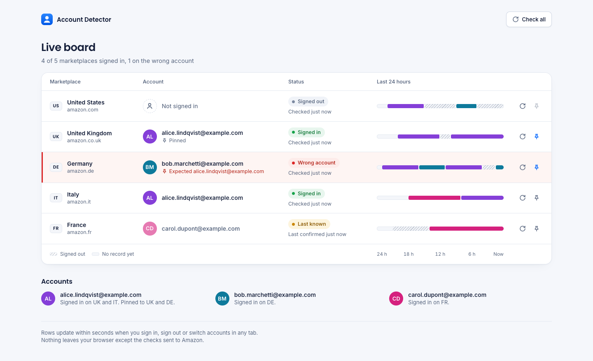
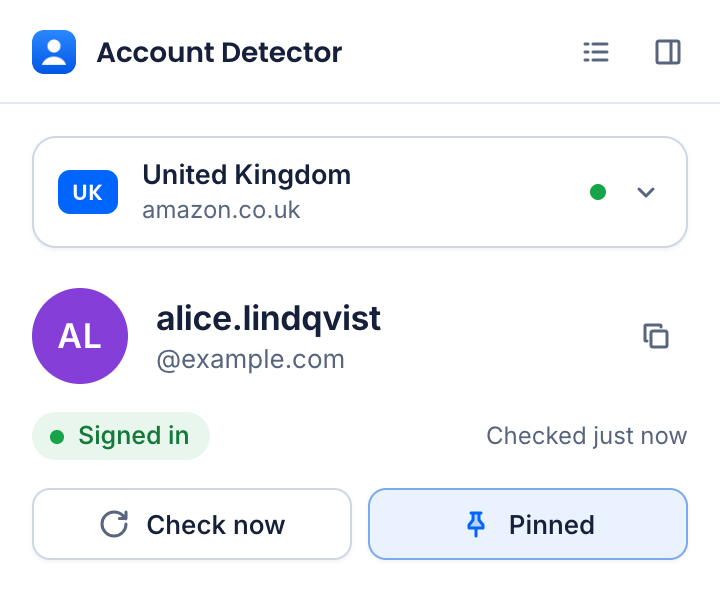
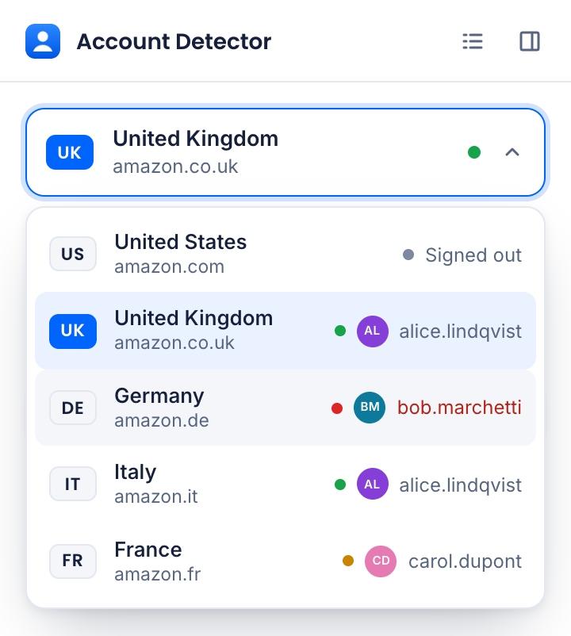
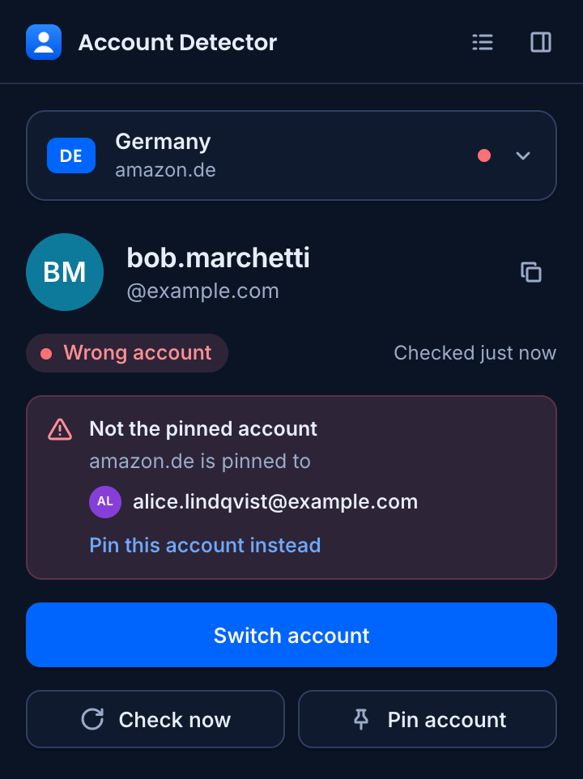

<p align="center">
  <picture>
    <source media="(prefers-color-scheme: dark)" srcset="docs/board-dark.png">
    
  </picture>
</p>

<h1 align="center">Amazon Account Detector</h1>

<p align="center">See which Amazon account is signed in on every marketplace, live, without touching your tabs.</p>

<p align="center">
  
  
  
  
  
</p>

## Install

Requires Chrome 116 or newer. No build step: the built extension is in `dist/`.

1. Download or clone this repository.
2. Open `chrome://extensions` and turn on **Developer mode**.
3. Click **Load unpacked** and choose the `dist` folder.
4. Pin **Amazon Account Detector** from the extensions menu so its icon stays in the toolbar.

To build it yourself, with Node 22 or newer: `npm install`, then `npm run build` writes the same `dist/`.

## Try the marketplace check

1. Click the toolbar icon and pick a marketplace from the dropdown. The last known state shows at once with its age, and a check runs if it is more than 5 minutes old. **Check now** always checks.
2. Sign in on that marketplace in any tab. Within a few seconds the popup shows the email, even while it is open.
3. Sign out in that tab. The popup switches to **Not signed in** by itself.
4. An answer older than 90 minutes, or one whose latest check failed, is labelled **Last known**, so old data never looks current.

<p align="center">
  
  
  
</p>

## Beyond the brief

- **Live board** of all five marketplaces, in a tab or Chrome's side panel (the list and panel icons in the popup header), with a 24-hour timeline of who was signed in when.
- **Wrong-account alarm:** pin the account a marketplace should use. The popup, the board and the toolbar badge turn red if another account is signed in.
- **Account colours and initials,** the same on every screen, and a note when the account changed since you last looked.
- **Toolbar badge** with the marketplace's state, and `amz` plus a space in the address bar for every account at once.

## How it works

No tabs, iframes or content scripts. The service worker reads the marketplace's auth cookie (none means signed out, with no request), confirms the session on the Your Account page, and reads the email from the sign-in page in the brief, with the `openid.assoc_handle` each marketplace needs, only for a new session or once a day. A cookie change triggers a recheck within about 1.5 seconds, an hourly alarm refreshes the rest, and a challenge or an error never reads as signed out.

The full write-up, with the reasons for each choice and what the real sites showed, is in [docs/how-it-works.md](docs/how-it-works.md).

## Tests

```sh
npm test       # 231 unit tests
npm run e2e    # 37 scenarios in Chrome for Testing against a local fake Amazon (set CHROME_PATH)
```
