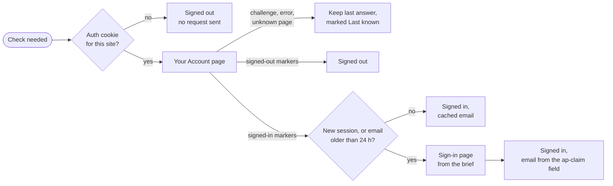
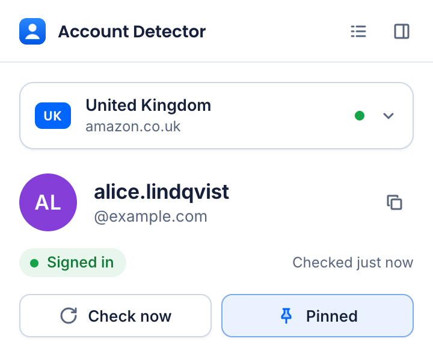
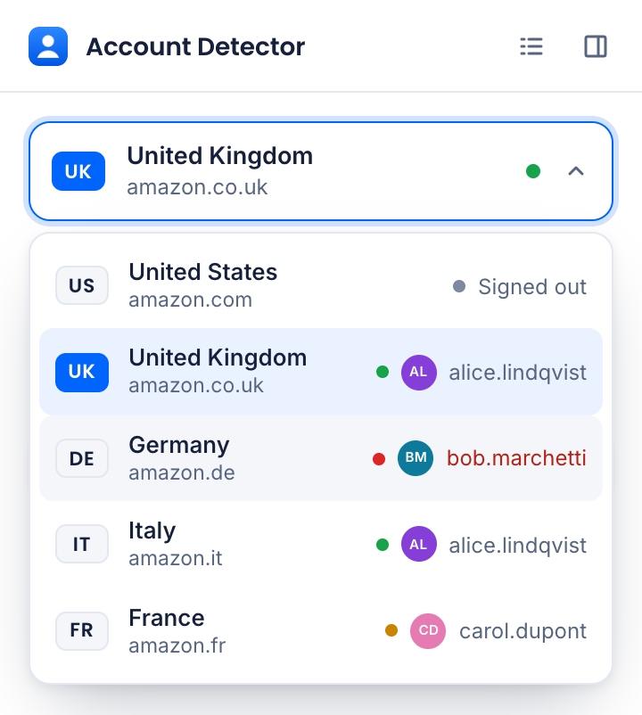
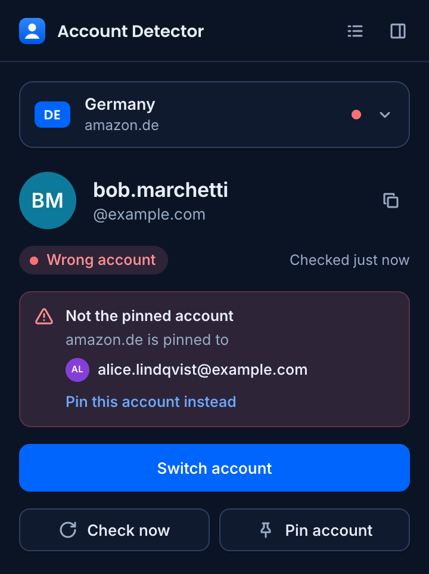

# How it works

The full write-up behind the [README](../README.md): what the extension does, how a check works, why it is built this way, what the real Amazon sites showed, the design, the tests, permissions and known limits.

## What it does

- **Popup.** Pick a marketplace from the dropdown and see who is signed in, how fresh that answer is, and what to do next. The dropdown itself shows the account on every marketplace, so one click answers "where am I signed in?".
- **Account colours.** Every account gets its own colour and initials, the same in the popup, the dropdown, the board and the timeline. The first account seen gets the first colour, so two accounts never share one until there are more than five.
- **Wrong-account alarm.** Pin the account a marketplace should use. If another account is signed in there, the popup, the board and the toolbar badge turn red before you order from the wrong one, with a one-click switch.
- **Live board.** All five marketplaces at once, in a tab or docked in Chrome's side panel. Sign in, sign out or switch accounts in any tab and the row updates within seconds, with a short highlight.
- **24-hour timeline.** Each marketplace shows which account was signed in when. Hover a bar for the account and the times, so "which account placed that order?" has an answer.
- **Changes while you were away.** When the account on a marketplace changed since you last opened the popup, it says so and names the account that was there before.
- **Address bar.** Type `amz` and a space in Chrome's address bar to see every marketplace's account without opening anything. Add `de` or part of an email to filter.
- **Toolbar badge.** The chosen marketplace's code: green when signed in, grey when not, amber when the answer is not current, red for the wrong account.

## How a check works



1. **Cookie jar, no network.** If the marketplace's auth cookie (`at-main`, `at-acbuk`, `at-acbde`, `at-acbit`, `at-acbfr`) is missing, you are signed out. Amazon is not contacted, so sites you never visit get no requests and no new cookies.
2. **Your Account page** (`/gp/css/homepage.html`) confirms the session is still alive, because cookies can outlive a session. It returns 200 either way, so the verdict comes from navigation markers that do not depend on language: `config.customerName` set plus `nav_youraccount_btn` when signed in, `false` plus `nav_ya_signin` when not.
3. **The sign-in page from the brief** gives the email, read from `input#ap-claim`. It is fetched only for a new session (the auth cookie changed) or when the cached email is more than 24 hours old.

Only positive evidence decides. A 202 AWS WAF challenge, a 403, a captcha, a network error or an unfamiliar page never becomes "signed out".

| Trigger | What happens |
| --- | --- |
| Popup opens or marketplace changes | Cached state shows at once; a check runs only if the answer is over 5 minutes old |
| **Check now**, or a row's check button on the board | Always checks |
| Auth cookie changes (login, logout, account switch) | That marketplace is rechecked about 1.5 seconds later, after Amazon's cookies settle |
| Hourly alarm | Marketplaces are refreshed one at a time with random gaps; ones without an auth cookie cost no request |
| After a challenge | Automatic checks pause for 6 hours. The popup asks you to open the site once, then press **Check now** |

Every answer shows its age, such as "Checked 3 min ago". It changes to **Last known** once the answer is older than 90 minutes or the latest check failed, so old data never looks current.

A check that finishes after a logout cannot bring the old email back. Every cookie change bumps a counter for that marketplace, and a result started under an older counter is dropped. The end-to-end run proves this: with the guard removed, it catches the stale answer being written.

## Why this approach

The aim was no effect at all on the tabs you are using.

- **Service worker `fetch` with your cookies.** No tab, window or content script. The manifest asks for no `tabs`, `scripting` or `activeTab` permission, so the extension cannot open, focus, reload or read tabs at all.
- **Not a hidden iframe.** `/ap/signin` sends `X-Frame-Options: SAMEORIGIN`. Removing that header would weaken Amazon's clickjacking protection.
- **Not a background tab.** It appears in the tab strip, can steal focus and runs Amazon's page scripts.
- **Not reading open Amazon tabs.** That only works when a tab happens to be open, and it needs access to page content.
- **Offscreen document for parsing.** Service workers have no `DOMParser`, and regular expressions over HTML break on small markup changes.
- **The built extension is committed.** The brief asks for a repository that loads as an unpacked extension, so `dist/` is in the repository and works without any tooling. `npm run verify` rebuilds it and fails if the committed copy differs from the source.

## What the real sites showed

Checked in Chrome 156 with two test accounts on 5 November 2026:

- `openid.assoc_handle` must match the site. `usflex` returns 404 everywhere except amazon.com. The others are `gbflex`, `deflex`, `itflex` and `frflex`.
- When you are signed in, the sign-in URL shows a password prompt for the active account only, not a list of accounts. The email sits in `input#ap-claim` in every language.
- When you are signed out, it shows an empty `#ap_email_login` field, even if Amazon remembers accounts.
- One login works on every marketplace. With two saved accounts, Sign Out switches to the remaining account, and the extension follows.
- A request without cookies can get a 202 AWS WAF challenge or a small bot-check page with status 200, so status 200 alone proves nothing.

## Design

<p align="center">
  
  
  
</p>

- **Trackerbot's look.** Blue, navy and white, Poppins for headings and Inter for everything else, both bundled so no page loads anything from the network. Light and dark mode follow the system.
- **The account is the hero.** The popup splits an email at the @, so the part that tells accounts apart reads first. Initials and a colour make the same account recognisable across every surface.
- **Colour has one job each.** Green, grey, amber and red only ever mean a state, and always come with a word. Account colours are violet, teal, magenta, blue and copper, chosen to stay clear of those. They were checked with a colour-blindness simulation (protanopia and deuteranopia): the first three stay distinct side by side, and every pair that can touch on the timeline does too.
- **Motion only when something changed.** A row that updates gets a short highlight, a new account fades in, the check icon spins while a check runs. Nothing moves on its own, and with reduced motion turned on nothing moves at all.
- **A real dropdown.** The marketplace picker follows the WAI-ARIA select-only combobox pattern: arrow keys, Home and End, Enter, Escape, type to find (`d` for Germany), and screen readers hear each marketplace with its state.
- **Accessible by test.** All text meets WCAG AA contrast (4.5:1) in both themes, and status dots and focus rings reach 3:1. A unit test reads the real CSS tokens to keep it that way; it caught two dark-mode colours during the redesign.

## Tests

```sh
npm test            # 231 unit tests
npm run e2e         # 37 scenarios: the built extension in a real Chrome, against a local fake Amazon
npm run verify      # types, unit tests, a fresh build, and a check that dist/ matches the source
npm run showcase    # renders the screenshots from the real extension
```

The unit tests cover the page classifier, the check flow, cookie signals, race handling, the history and timeline, account colours and pins, every dropdown key, the address bar, storage, colour contrast and every popup and board state.

The end-to-end run loads `dist` into a headless Chrome for Testing. Its host rules send the five Amazon hostnames to a local fake server and every other hostname nowhere, so nothing reaches the internet. Its scenarios include the dropdown driven by real key presses, going offline, a challenge, an expired session, a slow reply that lands after logout, a stopped service worker, the wrong-account alarm, a change while the popup was closed, copy to clipboard, live board updates, timeline hover, the side-panel layout, very long emails and phone-number accounts, reduced motion, six account switches in one second, and an open Amazon tab that must keep the text typed into it. It ends by checking that no extension page or the service worker threw a single error. Branded Chrome ignores `--load-extension`, so point `CHROME_PATH` at Chrome for Testing or Chromium:

```sh
CHROME_PATH="/path/to/Google Chrome for Testing" npm run e2e
```

Checked by hand on real Amazon: sign-in, a logout noticed by an already open popup, an account switch, Sign Out with two saved accounts, all five marketplaces, the hourly refresh and a browser restart.

## Permissions and privacy

| Permission | Why |
| --- | --- |
| `cookies` | Read each marketplace's auth cookie and hear about logins and logouts |
| `storage` | Keep records, pins, account colours and the 7-day history in `chrome.storage.local`, which is never synced |
| `alarms` | Hourly refresh |
| `offscreen` | Parse HTML with `DOMParser` |
| `sidePanel` | Dock the live board beside your tabs |
| Host access | The five marketplaces only |

The address-bar keyword needs no permission. Each record holds the status, the email, timestamps and the first 8 bytes of a SHA-256 hash of the auth cookie, which is how a new session is noticed. Cookie values are never stored. Nothing is sent anywhere except Amazon.

## Known limits

- A real server-side session expiry was not triggered on Amazon. That case is covered by the fake Amazon and the unit tests.
- "Signed in" means Amazon recognizes the session. Amazon may still ask for the password before it shows orders or account settings.
- An account with no email, only a phone number, shows the phone number.
- If Amazon changes its markup, checks report an unrecognised page instead of guessing.
- The timeline starts when the extension is installed and keeps seven days.
- Fetching the sign-in page rewrites one of Amazon's sign-in cookies (`ap-fid`). That fetch only happens on a new session or once a day. Whether it can disturb a sign-in that is in progress in another tab at that exact moment was not tested.

## Project layout

```
dist/                   the built extension, ready for Load unpacked
src/background.ts       service worker: triggers, fetch, cookie events, badge, colours, address bar
src/check.ts            one check: cookie, account page, sign-in page
src/classify.ts         page verdicts and email extraction
src/service.ts          one check at a time per marketplace, late-reply guard, settle delay
src/history.ts          who was signed in when, and the timeline segments
src/identity.ts         account colours, initials and pins
src/view.ts             what every state says, shared by popup, board, badge and address bar
src/listbox.ts          the dropdown's keyboard behaviour
src/popup.ts            the popup
src/board.ts            the live board, in a tab or the side panel
src/omnibox.ts          address-bar suggestions
static/                 manifest, pages, design tokens and icons
test/                   unit tests
e2e/                    fake Amazon, end-to-end run, screenshot renderer
```
